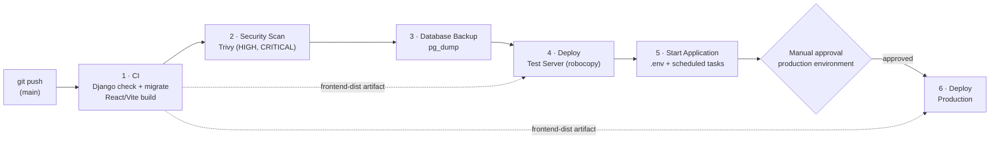
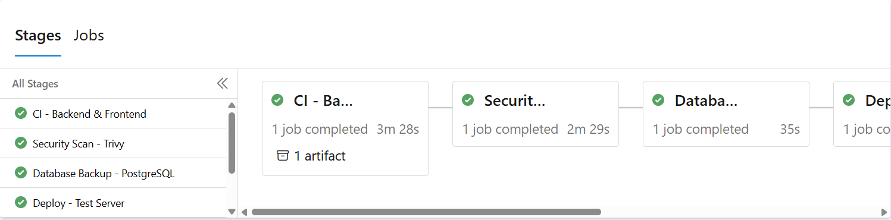
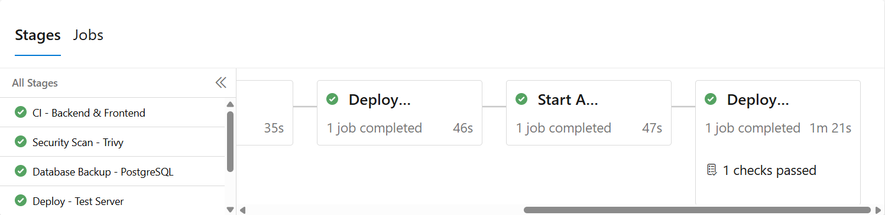
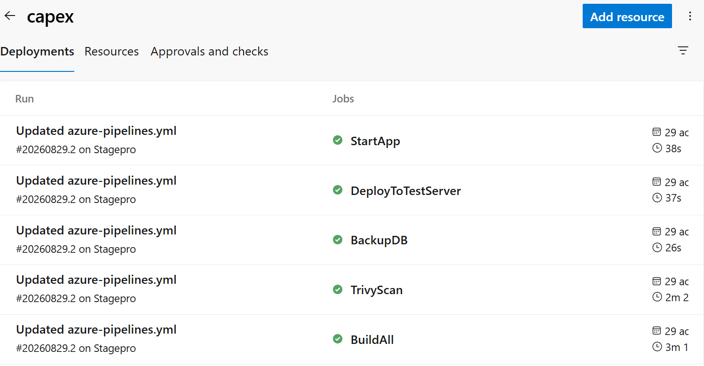

# ⚙️ Azure DevOps CI/CD Pipeline — Django + React application

Multi-stage CI/CD pipeline built during a DevOps internship at **LEONI** (Sousse, Tunisia) for an internal web application (Django REST API + React/Vite frontend + PostgreSQL).
The pipeline builds both parts, ships them to a **test** environment automatically and to a **production** environment only after **manual approval**.

> Only the pipeline definition and documentation are published here. The application source code belongs to the company and is not included.


---

## 🏗️ Pipeline overview



| # | Stage | What it does |
|---|---|---|
| 1 | CI - Backend & Frontend | Installs Python 3.11 and Node 20, runs `manage.py check` and migrations, builds React with Vite, publishes `frontend-dist` |
| 2 | Security Scan - Trivy | Installs Trivy if missing and scans backend and frontend dependencies for HIGH and CRITICAL vulnerabilities |
| 3 | Database Backup - PostgreSQL | Timestamped `pg_dump` of the database before every deployment; the stage fails if no backup file is produced |
| 4 | Deploy - Test Server | Downloads the frontend artifact and mirrors backend + frontend with `robocopy` (exit codes ≥ 8 fail the stage) |
| 5 | Start Application | Generates `.env` from secret variables and restarts the backend/frontend scheduled tasks |
| 6 | Deploy - Production | Same deployment to the production folder and ports, only after manual approval |

| Environment | Agent | Backend | Frontend | Trigger |
|---|---|---|---|---|
| Test (`capex`) | Self-hosted Windows agent | port 8085 | port 5173 | Automatic on every push to `main` |
| Production (`production`) | Separate self-hosted agent and environment resource | port 8090 | port 5180 | **Manual approval** in Azure DevOps |

---

## ✨ What I built

- **Multi-stage YAML pipeline** (`pipeline/azure-pipelines.yml`): CI build, security scan, database backup, test deployment and production deployment.
- **Security scan with Trivy** in a dedicated stage, before anything is deployed.
- **Automatic PostgreSQL backup** before each deployment, so a failed release can be rolled back without data loss.
- **Two self-hosted Windows agents**, each tied to its own Azure DevOps *environment* (test / production).
- **Artifact transport between stages** with `PublishPipelineArtifact` / `DownloadPipelineArtifact` for the compiled frontend.
- **Secret management**: `.env` files are generated at deploy time from Azure DevOps **secret variables** — no credential is stored in Git.
- **Deployment with `robocopy`** and correct exit-code handling (robocopy returns 1–7 on success).
- **Services kept alive with Windows Task Scheduler** (one task per backend/frontend and per environment).
- **Production gate**: an *Approvals and checks* rule on the production environment blocks deployment until a reviewer approves.

---

## 🧩 Problems I solved

| Problem | Root cause | Solution |
|---|---|---|
| Agent could not run as a Windows service | Service account permissions on the machine | Ran the agent and the app through **Task Scheduler** tasks instead |
| Deployment step marked as *failed* although files were copied | `robocopy` uses exit codes 1–7 for success | Mapped exit codes < 8 to success in the script |
| Django migrations failed in the pipeline | Environment variable names in the pipeline did not match the ones read by `settings.py` | Aligned variable names and generated the `.env` file from pipeline secrets |
| Frontend build missing in the deploy stage | Each stage runs in a fresh workspace | Published the `dist/` folder as a pipeline artifact and downloaded it in the deploy stage |
| Scheduled tasks failed without admin rights | Tasks created with elevated privileges only | Recreated tasks with the right user and permissions |
| Users could not log in after deployment | Two user models (`auth.User` vs a custom `User` model) and bcrypt password hashing | Unified authentication on one model with the correct password hasher |

---

## 📁 Repository structure

```
.
├── pipeline/
│   └── azure-pipelines.yml   # full multi-stage pipeline (sanitized)
└── docs/screenshots/         # pipeline runs, approval gate, environments
```

---

## 📸 Screenshots

**Successful run: CI, Trivy scan and database backup stages**



**Deployment stages: the production stage ran only after its approval check passed**



**Deployment history of the test environment, job by job**



---

## 🗺️ Next improvements
- Make the Trivy stage blocking (`--exit-code 1`) once existing vulnerabilities are fixed.
- Replace the deprecated `NodeTool@0` task with `UseNode@1`.
- Containerize the application with Docker to remove the dependency on the Windows agent.
- Add automated tests (pytest, Vitest) and a post-deployment health check.

## 🧠 What I learned
- Designing a release flow with separated environments and approval gates.
- Running and troubleshooting self-hosted agents on Windows.
- Handling secrets safely in CI/CD.
- Debugging across the whole chain: pipeline → OS permissions → application code.

**Author:** Amira Salah — Cloud Computing & Networks engineering student · [GitHub](https://github.com/amirasalah01)
